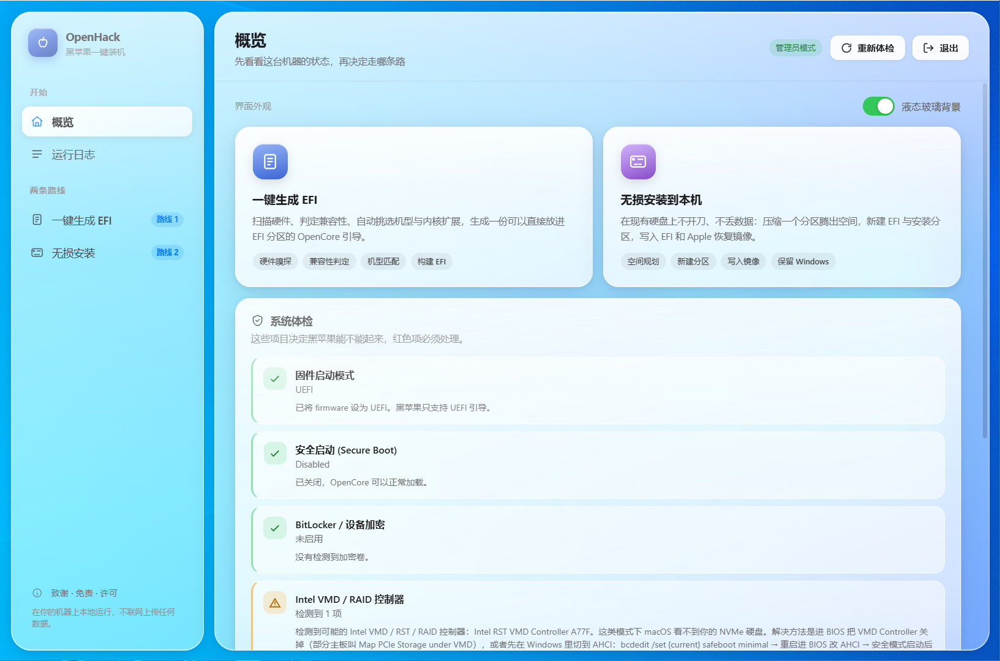

# OpenHack

**English** | [简体中文](README.md)

**A GUI Hackintosh builder for Windows.** Scan your hardware → check macOS compatibility →
generate an OpenCore EFI → optionally carve out an install partition on your existing disk
without wiping anything and write the Apple recovery image to it.

Everything runs locally; no hardware information leaves your machine. The UI is a local web page
(liquid-glass styling) hosted in a native Win32 window.



> **Noncommercial project.** Released under [PolyForm Noncommercial 1.0.0](LICENSE):
> free for personal, research, educational and nonprofit use — **commercial use is not allowed**.
> Reason: see [NOTICE.md](NOTICE.md) §4 (the NVIDIA driver ecosystem it depends on is noncommercial).

> ⚠️ Hackintosh itself violates Apple's software licence agreement, and this tool performs
> partition operations. Assess the risk yourself and **back up first**.

---

## What it can do

### 1. Tell you whether this machine can run macOS at all

- Scans CPU, motherboard, BIOS, GPU, audio, Ethernet, Bluetooth, storage controllers and USB
  controllers, and dumps **36 raw ACPI tables** (it only proceeds if the DSDT parses).
- Gives a **per-device** verdict: natively supported up to which macOS version / needs an OCLP root
  patch / not supported at all — not a vague "it works".
- Pre-flight checks that actually block a boot: UEFI mode, Secure Boot, BitLocker/device encryption,
  **Intel VMD / RST** (leaves your NVMe invisible), Above 4G Decoding, CSM.
- Each finding comes with the **concrete fix** (which controller to disable in BIOS, what to change
  with `bcdedit`), not just a red cross.

### 2. Generate an OpenCore EFI that is ready to boot

- Picks the SMBIOS model (e.g. `MacPro7,1`), the kext set (typically 18: Lilu, VirtualSMC, AppleALC,
  WhateverGreen, NVMeFix, RestrictEvents, USBToolBox…) and the ACPI patches
  (`SSDT-PLUG` / `EC` / `USBX` / `SBUS` / `RTCAWAC` / `USB-Reset`).
- Produces a complete `config.plist`: boot-args, SIP, SecureBootModel, `Kernel/Block`,
  model-specific settings.
- **Inspectable output**: the generated EFI lists every kext and SSDT, and every decision is logged.
  No black box — you can diff the result against the
  [Dortania guide](https://dortania.github.io/OpenCore-Install-Guide/) whenever you want.
- Version options are **derived from your hardware**: the native range, or — when the N-card driver
  is in play — only macOS 15 / 26.


### 3. Install alongside Windows without losing data

- Shrinks an existing NTFS partition (data inside the volume is untouched), or uses free space
  already at the end of the disk.
- Creates an EFI system partition + a macOS install partition and writes the OpenCore EFI into it.
- Downloads and writes the **official Apple recovery image** (macrecovery, including RSA
  verification of the chunklist).
- **Never deletes or formats an existing partition.** Detects pre-existing Apple partitions and warns
  you before anything is written.
- Every step is validated up front: not enough space is caught before touching the disk, not halfway through.


### 4. Make modern NVIDIA cards work (where most tools give up)

- Integrates the [NullMoth](https://github.com/nullmoth/nvidia-macos-driver) third-party driver:
  Turing and newer (GTX 16 / RTX 20 / 30 / 40 / 50, TITAN RTX, some Quadro) get graphics
  acceleration on **macOS 15 Sequoia / macOS 26 Tahoe**.
- Writes every hard requirement the driver documents: 7 boot-args, SIP `430A0000`,
  `SecureBootModel = Disabled`, `Kernel/Block` on `IONDRVSupport`, and pulls in AMFIPass.
- Stages the driver package (~256 MB) to `NullMoth/` on the ESP, with a README explaining how to
  install it once macOS is up.
- **Two tiers, honestly separated**: `tested` (physically verified by the driver author — currently
  only `2D05`) and `listed` (present in NVIDIA's firmware support table, *not* verified).
  The UI never presents `listed` as "guaranteed to work".

### 5. Details that keep it from being annoying

- **Downloads work from mainland China**: mirrors for OpenCore, kexts and recovery images, so it
  doesn't stall on `raw.githubusercontent.com`.
- **No console windows**: this is a GUI-subsystem binary, every child process gets
  `CREATE_NO_WINDOW`, and even `os.system('cls')` is intercepted — scanning won't flash black boxes.
- **Single file**: one 17.8 MB exe with the backend and the WebView2 loader appended to its tail.
  Run it from any directory.
- **Debuggable**: every decision and failure reason is written to
  `%LOCALAPPDATA%\OpenHack\data\`.

## What it does **not** do

- **It does not change your BIOS.** It tells you which setting to flip; you flip it.
- **It does not ship macOS.** It only fetches the recovery image from Apple's official CDN.
- **No Apple Silicon / ARM support.** x86_64 desktops and laptops only.
- **It cannot guarantee every NVIDIA card works.** `listed` literally means "not verified".
- **No code signing.** Windows will warn about an unknown publisher; a code-signing certificate is
  out of reach for an individual project.
- **It is not a replacement for the documentation.** The generated EFI works, but you should know
  what you're installing — when something breaks, Dortania's guide is the primary source.

## Two workflows

| Workflow | What it does | Touches your disk? |
|---|---|---|
| **① Generate EFI** | Scan → compatibility verdict → pick model / kexts / ACPI patches → build the OpenCore EFI | **No**, files only |
| **② Lossless install** | Shrink an existing partition → create ESP + macOS install partition → write EFI and recovery image | **Yes**, but only shrinks existing partitions; **nothing is deleted or formatted** |

You can use ① alone (make your own USB installer) or run ①→② end to end.

## Requirements

- Windows 10 19045+ or Windows 11, 64-bit
- **Administrator rights** for the lossless install and ACPI dumping
- WebView2 Runtime (bundled with Windows 11; if missing on Windows 10 the app falls back to your
  system browser automatically)
- Internet access for EFI generation and the recovery image

## Usage

Download `OpenHack.exe` from [Releases](releases) and double-click it.

It is a **single file**: the Python backend and the WebView2 loader are appended to the exe and
unpacked to `%LOCALAPPDATA%\OpenHack\bin` on first run. Subsequent runs compare a `buildId`, so the
payload is not rewritten every time.

**The exe is ~48 MB because it embeds the offline assets** (OpenCorePkg plus every kext: 52 MB raw,
~32 MB compressed). It exists for one reason: **so you can generate an EFI with no route to GitHub
at all**. On first run it releases them into `%LOCALAPPDATA%\OpenHack\data\cache` — and only once,
when the cache is empty, so a kext you fetched yourself later is never overwritten by the seed.

> The ~256 MB NullMoth NVIDIA driver package is *not* included: it's only needed for N-card
> acceleration, and there's no reason to make everyone carry it.

Output locations:

| Artifact | Path |
|---|---|
| Hardware report + raw ACPI tables | `%LOCALAPPDATA%\OpenHack\data\reports` |
| Generated EFI | `%LOCALAPPDATA%\OpenHack\data\results\EFI` |
| Download cache (OpenCore / kexts) | `%LOCALAPPDATA%\OpenHack\data\cache` |
| Logs | `%LOCALAPPDATA%\OpenHack\data\launcher.log`, `server.log` |

## Run from source

```powershell
python -m venv runtime
runtime\Scripts\python -m pip install -r requirements.txt
runtime\Scripts\python launcher.py
```

The browser opens `http://127.0.0.1:8733/` automatically. During frontend work you can just reload
that page.

## Building the single-file exe

Requires **Python 3.13** + **PyInstaller**, plus **LLVM-MinGW** and the **WebView2 SDK** for the
native shell.

```powershell
# 1) Backend (PyInstaller onefile) -> dist\OpenHackCore.exe
python _test/build_exe.py

# 2) Native shell (C++, embeds the backend) -> single file
python native/build_native.py
```

`native/build_native.py` appends `OpenHackCore.exe` and `WebView2Loader.dll` to the tail of
`OpenHack.exe` and writes a 32-byte footer (`coreLen / dllLen / buildId / "OHPK0001"`).
At startup the exe locates the payload through that footer and extracts it; it only overwrites when
the `buildId` differs.

> The repository directory is still named `GlassHack` and the spec file is still `GlassHack.spec` —
> leftovers from the project's earlier name. The product is OpenHack everywhere.

## Architecture

```
OpenHack.exe            Native shell: C++ / Win32 borderless window + DWM material + WebView2
  └─ embedded OpenHackCore.exe   Python backend: HTTP + SSE, dispatches worker subprocesses
       ├─ app/worker_scan.py    hardware scanning (Hardware-Sniffer)
       ├─ app/worker_efi.py     compatibility analysis / EFI build (OpCore-Simplify)
       └─ app/worker_install.py partitioning and image writing (diskpart / macrecovery)
  └─ web/               Frontend: plain HTML/CSS/JS, no framework, no external assets
```

Some deliberate trade-offs:

- **Workers always run as separate subprocesses.** WMI/COM calls inside a GUI process's worker
  threads tend to deadlock; isolating them is far more stable.
- **Upstream sources are not edited.** All adaptation of OpCore-Simplify happens through runtime
  monkey patches in `app/autopilot.py`, so upstream upgrades produce a readable diff. The one
  exception is documented in [vendor/NOTICE.md](vendor/NOTICE.md).
- **One continuous progress bar.** Scanning occupies 0–30 %, analysis continues from 32 % to 100 %,
  so you never see "finished scanning but stuck at 9x%".
- **No frontend framework.** The whole UI is ~100 KB; that keeps the exe small and contributors don't
  need a build chain.

## Known limitations

- **Browser fallback when WebView2 is unavailable.** On a few machines (some VMs, GPU-less sessions)
  the WebView2 renderer crashes. The app remembers that and opens the UI in your system browser
  instead — same functionality, minus the native window material.
- **NVIDIA cards: macOS 15 / 26 only.** The NullMoth driver only builds NVAccel for those two
  releases, so the version dropdown doesn't offer macOS 14 or earlier. Forcing another version
  produces an explicit warning.
- **NVIDIA support has two tiers**: `tested` (verified by the driver author) and `listed`
  (only in NVIDIA's firmware table).
- **No Apple Silicon / non-x86 support.**

## FAQ

**Progress bar frozen / garbled Chinese text while scanning?**
Fixed. The causes were a missing `wmi` dependency and the worker's stdout falling back to cp936.
If it still happens, check `%LOCALAPPDATA%\OpenHack\data\launcher.log`.

**The generated EFI has an empty ACPI folder?**
Fixed. Early versions passed the UI's "auto" preset down as "disable everything". The engine now
selects patches based on your CPU / motherboard.

**A black console window flashes during scanning?**
Fixed. Upstream runs `os.system('cls')`, which bypasses `subprocess` and had to be intercepted separately.

**Downloading OpenCore / kexts spins forever, or reports "resource download failed"?**
It normally **doesn't need the network at all**: the exe embeds the offline assets (OpenCorePkg plus
every kext) and releases them into the local cache on first run. If it still fails, the cache is
probably corrupt or you're on an older build:

1. Delete `%LOCALAPPDATA%\OpenHack\data\cache` and restart the app so the embedded assets are
   released again;
2. Or retry on another network / behind a proxy (a successful fetch is cached, so later builds stay
   offline);
3. If you only want the compatibility verdict, "scan + analyse" is enough and needs no network.

**NVIDIA driver support** still requires downloading that ~256 MB driver package — it is not part of
the offline assets.

**Windows says "unknown publisher"?**
The exe isn't code-signed. Verify a download by comparing against `SHA256SUMS.txt` from this
repository's Releases.

## Licence

[PolyForm Noncommercial 1.0.0](LICENSE). Third-party attribution — and which components ship in this
repository versus are downloaded at runtime — is in [NOTICE.md](NOTICE.md); modifications to
`vendor/` are described in [vendor/NOTICE.md](vendor/NOTICE.md).

## Credits

This project stands on a lot of open-source work: OpCore-Simplify, Hardware-Sniffer,
OpenCorePkg / Acidanthera, OpenCore Legacy Patcher, the Dortania install guide, NullMoth's NVIDIA
driver, plus SSDTTime and USBToolBox. The full list with licences is in [NOTICE.md](NOTICE.md).

## Contact

**Takedown / licensing**: if you own a work used here and would rather it weren't (missing credit,
incompatible licence, or simply not what you want), email **shaengli@163.com** with the file or
component in question. I'll remove or replace it in the next commit — no justification needed.

**Usage questions, suggestions, or documentation errors**: the same address, or open an
[issue](issues).
